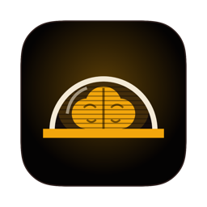
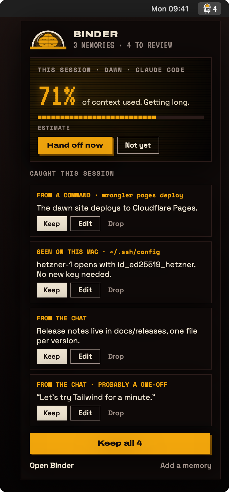
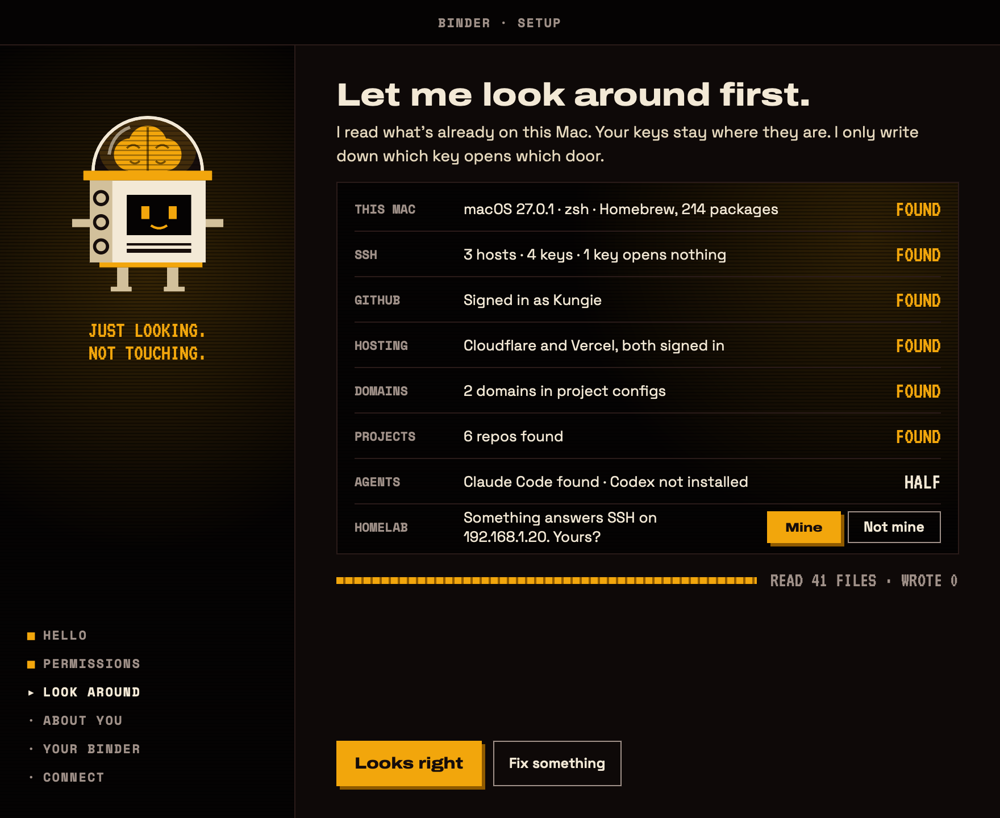

<h1 align="center">
   
  Binder
</h1>

A memory for your AI agents. Remembers you, your machines, your hosting and your SSH keys, so a fresh Claude Code session doesn't ask where the site is hosted.

  
  
  

---

AG~~I~~M. Artificial General ~~Intelligence~~ Memory.

Long AI sessions get worse the longer they run. Fresh ones don't know the topic. Binder takes that trade-off away: it keeps what your agents keep asking for in plain Markdown, and hands it to every new session.

## What it does

**Looks around first.** Binder reads what's already on your Mac:
- `~/.ssh/config` and the names of your keys
- the git and `gh` identity
- the hosting CLIs you're signed in to (Vercel, Netlify, Fly, Cloudflare, Hetzner, Supabase)
- your projects' deploy files and domains
- your homelab, if you let it knock on the local network

It writes all of that down, so agents stop guessing.

**Keeps itself fresh.** When a later decision makes an older one untrue, the older one moves to the note's `## Superseded` section: still in the file, off the card, one click to restore. The card stays under about a thousand tokens.

**Catches what sessions decide.** When a Claude Code session ends, Binder notes what the agent actually did. For example, `wrangler pages deploy` becomes "the site deploys to Cloudflare Pages". It shows each catch in the menu bar for you to keep or drop. Keep sends it into Binder's brain, Drop shreds it. If you say yes, it also reads the session with your own Claude plan to catch decisions that were only said out loud.

**Briefs every new session.** At session start Claude Code gets a short card: who you are, how you like to work, this project, its servers and keys, and where the last session stopped. The main window shows exactly what the agent sees.

**Hands off long sessions.** When a session is getting long, Binder says so. One click writes a handoff card and opens a fresh session in the same folder, which starts with the card.

## Install

Needs macOS 14+ and [Claude Code](https://docs.claude.com/en/docs/claude-code/setup).

Download `Binder.dmg` and drag Binder into Applications. It isn't notarized, so the first time you open it, go to System Settings › Privacy & Security and click **Open Anyway**. Setup takes about two minutes.

To build it yourself: `git clone https://github.com/Kungie/binder.git && cd binder && make install`

## Releasing

`make release` builds the DMG and zip and writes `Binder.zip.sig` with the release key from the login Keychain (`swift scripts/update-key.swift` makes it once). Upload all three to the GitHub release; the app ignores a release without the signature.

## The CLI

The app ships the `binder` CLI at `Binder.app/Contents/Helpers/binder`. Claude Code's hooks call it:

| Command | Called by | What it does |
|---|---|---|
| `binder card` | SessionStart | gives the agent its context card |
| `binder capture` | Stop | catches what the session did |

You can also run these yourself:

| Command | What it does |
|---|---|
| `binder observe` | looks around again |
| `binder handoff` | writes a handoff card |
| `binder install` / `binder uninstall` | adds or removes the hooks |
| `binder doctor` | checks that everything is wired up |
| `binder tidy [--all]` | moves repeated and outdated lines to each note's Superseded section |

## Good to know

- Everything stays on your Mac. There's no account, no cloud and no telemetry.
- Binder updates itself. Once a day it asks GitHub whether there's a newer release, and **Update** in the menu bar installs it. Every update is signed, and Binder only installs one that carries its release key's signature. An update replaces the app and nothing else: your binder, settings and hooks stay as they are. Settings › Updates turns the daily check off and has a **Check for updates** button.
- Binder never writes to `~/.ssh` and never opens a private key. It stores pointers to secrets ("the token is in 1Password"), never the secrets themselves, and anything that looks like a token is filtered out before it's saved.
- Your binder is a plain Markdown folder (`~/Binder` by default) that you can open in Obsidian or any editor. Binder only rewrites the lines between its observed markers; everything else is yours.
- Binder is an independent project, not affiliated with Anthropic. Claude is a trademark of Anthropic, PBC.

## Licence

[AGPL-3.0](LICENSE). Fonts under the SIL Open Font License, see `Sources/BinderUI/Resources/Fonts`.
