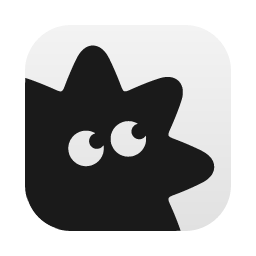
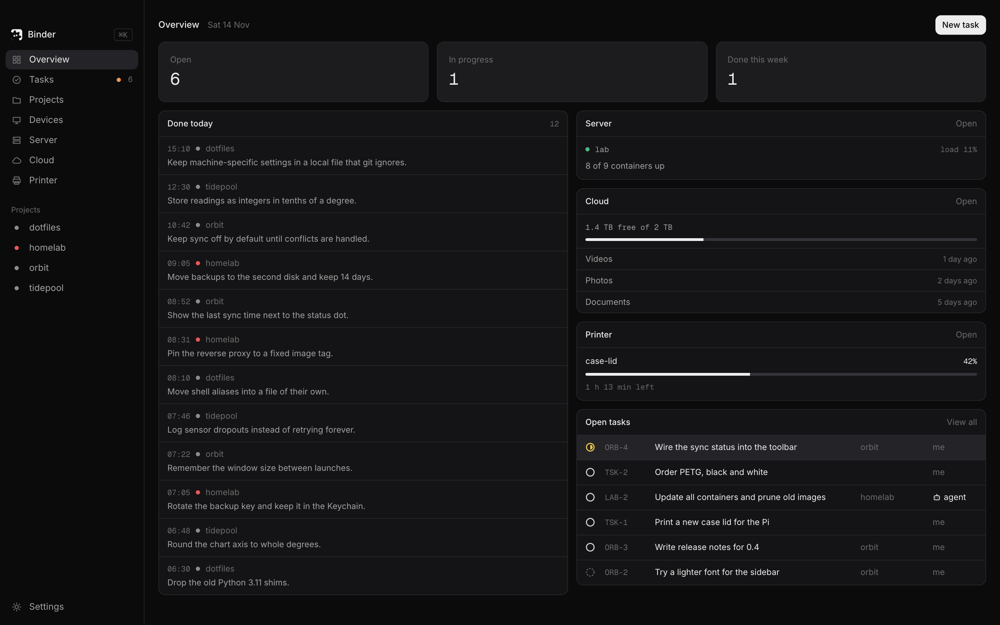
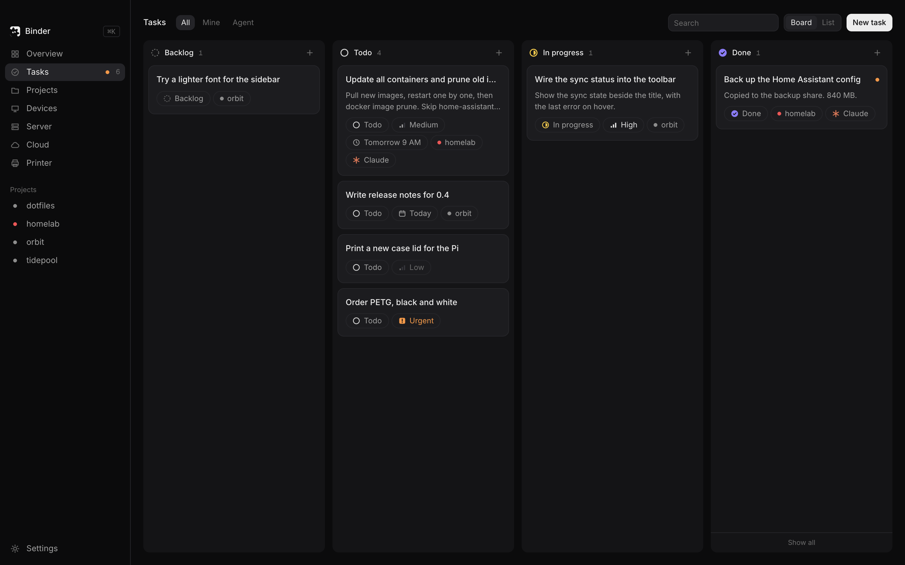
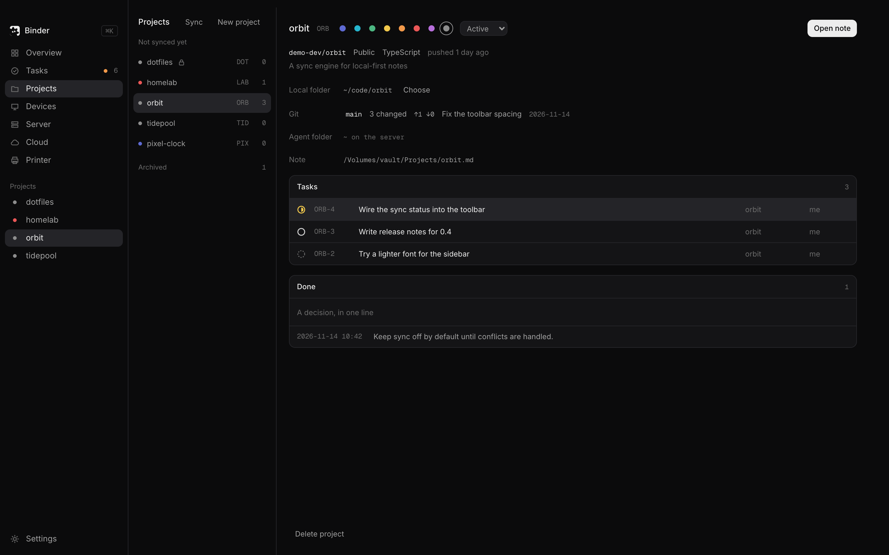
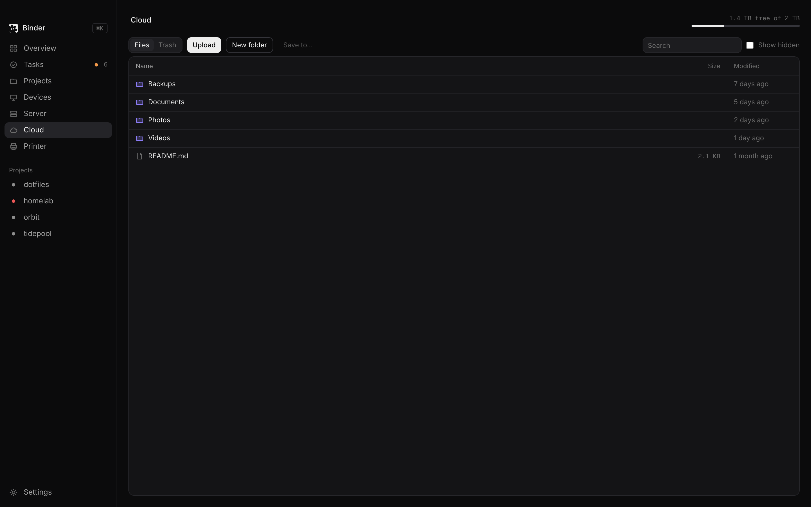
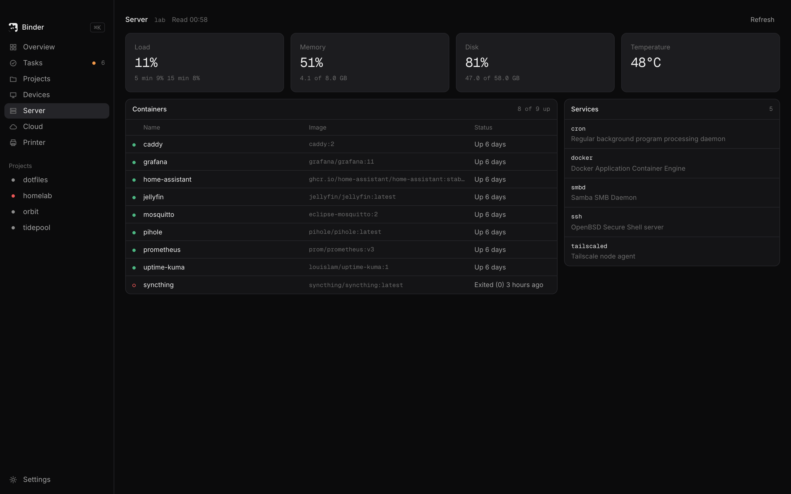

<p align="center">
  
</p>

<h1 align="center">Binder</h1>

<p align="center">A small desktop app for running one developer's workshop: tasks for you and a Claude Code agent, your GitHub projects, the home server, a file manager over it and a 3D printer.</p>

<p align="center"><a href="https://binder.erenkahraman.dev">binder.erenkahraman.dev</a></p>

<p align="center">
  <a href="https://github.com/Kungie/binder/releases/latest"></a>
  
  <a href="LICENSE"></a>
</p>

<p align="center">
  <a href="https://github.com/Kungie/binder/releases/latest/download/Binder.dmg"></a>
</p>

<p align="center">
  
</p>

Binder is mostly black and white, with a few colours that each mean something, keyboard first, and built for one person. The core is Rust, the window is Tauri with a React interface, and the data stays on your own machines.

## What it does

- **Tasks:** a board with Backlog, Todo, In progress and Done columns, or the same tasks as a keyboard-first table. Cards show two lines of notes and chips for status, priority, due date, project and the agent. Drag a card to change its status or its place. A task assigned to the agent gets a **Run** button that starts `claude -p` on the home server over SSH, in the background, and follows it until it ends; an orange dot marks it when the run ends.
- **Projects:** your GitHub repos come in on their own through the `gh` CLI and its login, at start and with **Sync**. Your own edits stay, and nothing is deleted: a repo that's archived or gone moves to Archived, and a project you delete stays gone until you bring it back. Projects that aren't on GitHub can be added by hand. A project can have a local folder (branch, changes, ahead and behind, last commit) and an Obsidian folder with its note and a daily file of decisions.
- **Claude Code:** Settings › Claude Code adds three hooks. Sessions are matched to a project by folder or by the repo's GitHub remote. When a session has enough new talk, Haiku picks out up to three key decisions, after secrets are masked, and writes them to the project's daily file. Overview shows today's lines.
- **Cloud:** a file manager over a folder on the home server, shared over SMB. Right-click menu, multi-select, Quick Look, Open with, zip and unzip on the server, and a transfer tray with progress. With SSH set up, folders move as one stream, so a `node_modules` takes seconds. More than one disk works, each with its own trash. Your phone reaches the same folder from the Files app.
- **Server:** containers, running services, load, memory, disk and temperature, read over SSH every 30 seconds. Read only.
- **Devices:** your machines and whether each one answers.
- **Printer:** a Bambu Lab printer in LAN mode over MQTT: job, progress, temperatures, pause, resume and stop.

<p align="center">
  
  
</p>
<p align="center">
  
  
</p>

## Install

Download `Binder.dmg` from the [latest release](https://github.com/Kungie/binder/releases/latest) and drag Binder into Applications. It runs on Apple silicon Macs. Binder isn't notarized, so the first launch needs System Settings › Privacy & Security › Open Anyway.

## Setup

- **Server:** Settings › Home server takes an SSH target, `user@host` or a `Host` from `~/.ssh/config`. Binder uses your keys through the system `ssh` and never stores a password.
- **Vault:** the Obsidian vault can live anywhere that mounts as a folder, such as an SMB share. Each project gets a folder with its note and daily files. Binder writes only when the vault is mounted; done lines wait otherwise.
- **GitHub:** install the GitHub CLI and run `gh auth login` once. Binder never reads or stores a token.
- **Cloud:** on the server, run `sudo scripts/cloud-share.sh <user>` once. It creates `/srv/cloud` and shares it as `[cloud]`. On the Mac, connect to `smb://<server>/cloud` in Finder, save the password in the Keychain, add the share to Login Items and put the same address in Settings › Cloud. On a phone, use Files › Connect to Server with the server's Tailscale address.
- **Printer:** the access code goes to the login Keychain, never to a file.
- macOS asks once for Local Network access. Allow it, or Binder can't reach addresses on your LAN.

Settings live in `~/Library/Application Support/io.github.kungie.binder/config.toml`, data in `binder.db` beside it.

## Build

You need Rust, Node with npm, and the Xcode Command Line Tools.

```sh
make dev      # run the app with hot reload
make test     # Rust and interface tests
make build    # build Binder.app, with binder-cli inside
make install  # build, then replace /Applications/Binder.app
make preview  # the interface alone in a browser, with demo data
```

The 1.x app, a Swift menu bar app that gave AI agents a memory, lives on the `legacy-swift` branch and in the 1.x releases.

## License

AGPL-3.0.
