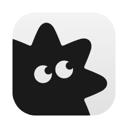
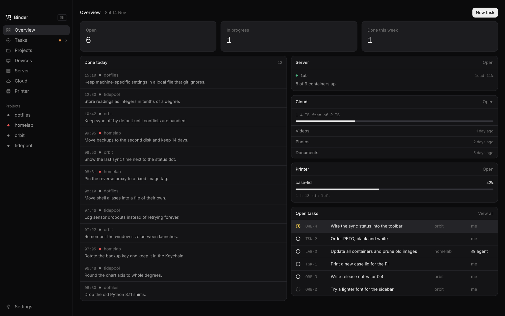
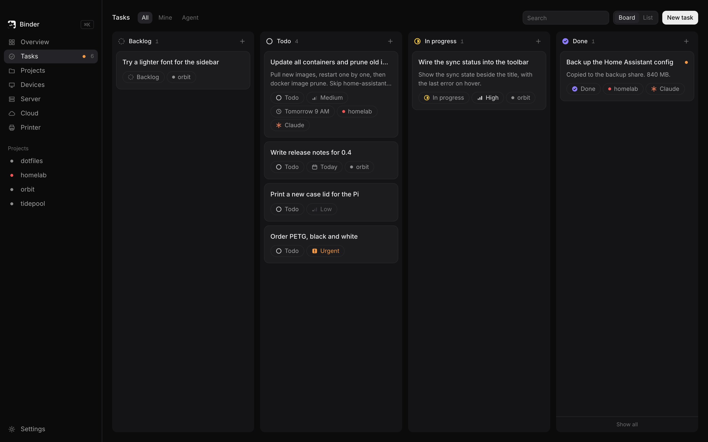
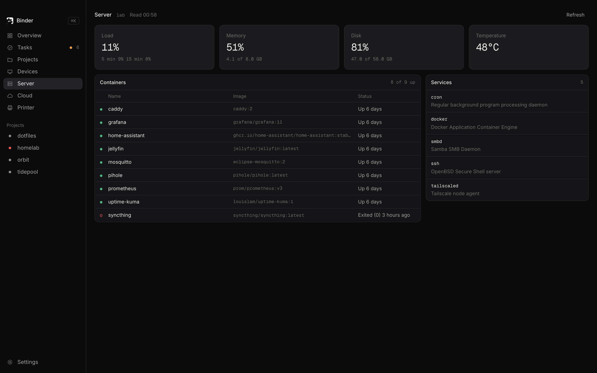
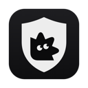

  

<h1 align="center">Binder</h1>

One Mac window for a developer's workshop: tasks for you and a Claude Code agent, GitHub projects, your home server and what runs on it, devices, a VPN of your own and a 3D printer.

  
  
  

  

  

## What's inside

| Screen | What it does | Needs |
|---|---|---|
| Tasks | A board and a table for you and a Claude Code agent that runs on your server, by day or at night | Nothing; the agent needs the server |
| Projects, GitHub | Repos, pull requests and issues through `gh`, a note per project in Obsidian | `gh auth login`, a vault folder |
| Servers, Sites, Agents | Containers, services, disks and websites on your server; terminals into tmux sessions there | SSH with your keys |
| Cloud | A file manager over a folder on the server shared over SMB | An SMB share |
| Devices, VPN | Your computers through Tailscale, Taildrop, and your exit nodes as VPN regions | Tailscale |
| Printer | A Bambu printer in LAN mode: progress, camera, alerts | The printer's access code |

The first launch walks you through the server, the vault and `gh`, and each screen says what it still needs. Everything stays on your machines.

  
  

## Binder VPN

Share your exit nodes with friends. They get a small menu bar app and sign in with a user name and a password you make on Binder's VPN screen, then pick a region. Tailscale makes the tunnel; their devices are tagged `tag:friend` and reach the internet and nothing else on your tailnet.

1. On the VPN screen, Friends › Install service runs the sign-in service in Docker on your server (`127.0.0.1:8787`).
2. Add the policy it shows to your tailnet, and give it a Tailscale OAuth client with Auth Keys and Devices Core write access.
3. Make it public over https (`tailscale funnel --bg 8787`, or a tunnel) and save the address.
4. Add a friend and send the invite. They need Tailscale and [Binder VPN](https://github.com/Kungie/binder/releases/latest/download/Binder-VPN.dmg).

## Install

Download [Binder.dmg](https://github.com/Kungie/binder/releases/latest/download/Binder.dmg), drag it into Applications and open it once with System Settings › Privacy & Security › Open Anyway (it isn't notarized). Apple silicon only. Updates are signed and install from Settings › Binder.

## Security

Binder never stores a password: SSH uses your keys, GitHub uses `gh`'s login, the printer code sits in the Keychain. Every server command quotes its values, previews of websites run no scripts, and session text is masked before a model sees it. The VPN service hashes passwords with scrypt, locks out after repeated failures, hands out one-time keys and runs read-only without root.

## Build

Rust, Node and the Xcode Command Line Tools. `make dev` runs it, `make test` tests it, `make build` builds `Binder.app`, `make vpn` builds Binder VPN, `make preview` shows the interface in a browser with demo data.

## License

AGPL-3.0.
